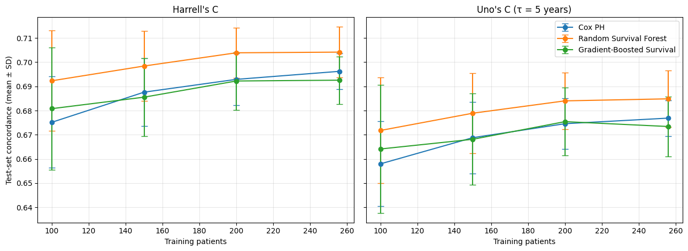
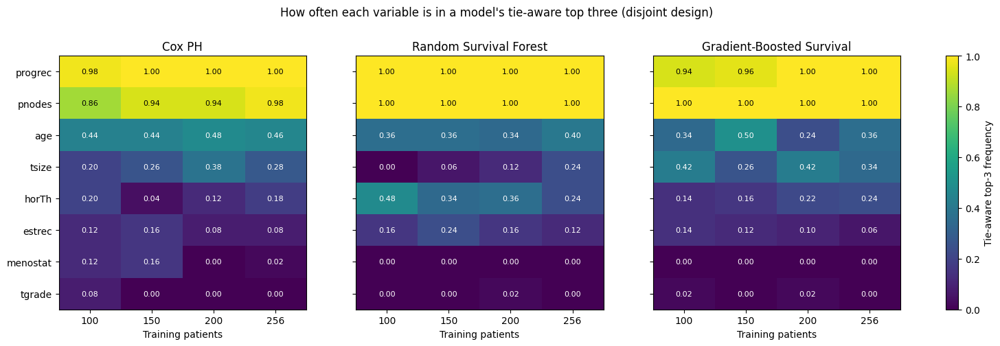
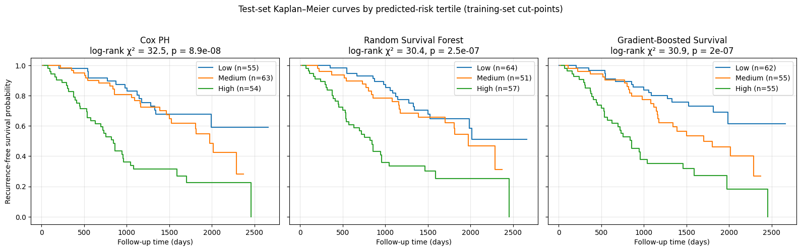
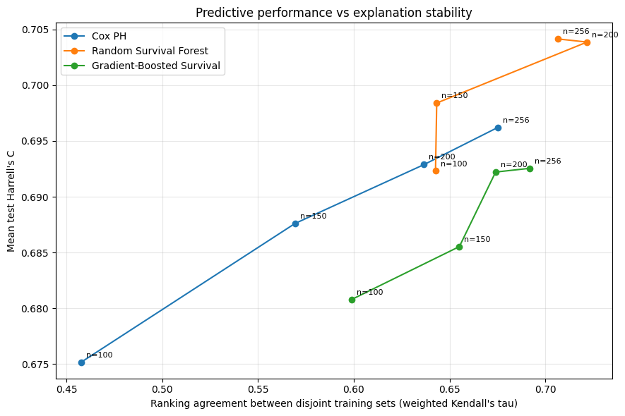

# Transparent Survival Analysis Using Tree-Based Ensembles

Investigating how training sample size affects predictive performance and feature-importance stability across survival models using the German Breast Cancer Study Group 2 (GBSG2) dataset.

[View the analysis notebook](survival_analysis_gbsg2.ipynb)

## Project Overview

Survival analysis studies the time until an event occurs while accounting for observations in which the event has not been observed by the end of follow-up (censoring).

Machine learning models can identify patterns associated with patient outcomes, but predictive performance does not necessarily mean that a model's explanations are consistent. This project examines the relationship between training sample size, predictive performance, and feature-importance stability.

The analysis addresses three questions:

1. How does training sample size affect the predictive performance of survival models?
2. How does training sample size affect the stability of feature-importance rankings across different patient samples?
3. Does using overlapping training samples make feature-importance rankings appear more stable than using disjoint samples?

## Key Visual Results

The figures below summarize predictive performance, risk stratification, and feature-importance stability.

### 1. Predictive Performance Across Training Sample Sizes

Compares Cox Proportional Hazards, Random Survival Forest, and Gradient-Boosted Survival models as training sample size changes.



### 2. Feature-Importance Ranking Stability

Shows how consistently predictors are ranked as important across training sample sizes and survival models.



### 3. Patient Risk Stratification

Kaplan–Meier curves show the observed survival experience of patients assigned to low-, medium-, and high-risk groups by each model.



### 4. Predictive Performance and Explanation Stability

Highlights the distinction between predictive performance and feature-importance ranking agreement.



## Dataset

The analysis uses the German Breast Cancer Study Group 2 (GBSG2) dataset, accessed through the `scikit-survival` Python package. No separate CSV download is required.

- **Patients:** 686
- **Predictors:** 8
- **Observed events:** 299 (43.6%)
- **Censored observations:** 387
- **Missing values:** 0

The event indicator represents recurrence or death. Follow-up time records the time to the event or the end of observation.

| Variable | Description |
|---|---|
| `age` | Patient age |
| `estrec` | Estrogen receptor measurement |
| `horTh` | Hormonal therapy |
| `menostat` | Menopausal status |
| `pnodes` | Number of positive nodes |
| `progrec` | Progesterone receptor measurement |
| `tgrade` | Tumor grade |
| `tsize` | Tumor size |

A stratified 75% training / 25% test split was created using a fixed random seed:

- **Training set:** 514 patients
- **Test set:** 172 patients

## Models

Three survival models were compared:

- **Cox Proportional Hazards (Cox PH):** A statistical survival model used as a baseline.
- **Random Survival Forest (RSF):** An ensemble of survival trees that can capture nonlinear relationships and interactions.
- **Gradient-Boosted Survival (GBS):** A boosting-based survival model that builds an ensemble sequentially.

The Cox model's functional form was selected using cross-validation. Random Survival Forest and Gradient-Boosted Survival hyperparameters were tuned using five-fold cross-validation on the training set.

## Methodology

The analysis follows these steps:

1. **Exploratory data analysis:** Examine predictor distributions, missing values, event rates, and overall survival patterns.
2. **Preprocessing:** One-hot encode categorical variables, fitting the encoder on the training data only.
3. **Model development:** Fit and tune the three survival models.
4. **Predictive evaluation:** Evaluate model performance on the held-out test set.
5. **Risk stratification:** Divide test patients into low-, medium-, and high-risk groups using predicted risk, then compare their survival patterns.
6. **Feature importance:** Use grouped permutation importance to measure how much model performance changes when each original predictor is shuffled.
7. **Noise analysis:** Estimate how much feature-importance rankings change due to permutation randomness alone.
8. **Sample-size experiment:** Train models using samples of 100, 150, 200, and 256 patients and compare rankings across independently drawn samples.
9. **Overlap comparison:** Compare disjoint training samples with overlapping samples to assess how shared patients affect apparent ranking stability.

The sample-size experiment uses 25 pairs per sample size. In the disjoint design, the two models in each pair are trained on non-overlapping patients. The overlapping design provides a comparison. A size-matched baseline estimates agreement when the same fitted model is evaluated using different permutation shuffles.

## Evaluation Metrics

### Predictive performance

- **Harrell's C-index:** Measures how well a model ranks patients by risk. Higher values indicate better discrimination.
- **Uno's C-index:** An alternative concordance measure that accounts for censoring.
- **Time-dependent AUC:** Measures discrimination at specified follow-up times.
- **Integrated Brier Score (IBS):** Measures prediction error over time. Lower values indicate better performance.

Bootstrap confidence intervals and paired model comparisons were calculated for Harrell's C-index.

### Feature-importance stability

- **Spearman correlation:** Measures agreement in the overall ranking of features.
- **Weighted Kendall's tau:** Measures ranking agreement while giving greater weight to important positions.
- **Tie-aware top-3 Jaccard index:** Measures overlap between the most important feature sets while retaining ties at the third position.

## Key Findings

### 1. Predictive performance

On the held-out test set, Random Survival Forest had the highest Harrell's C-index (0.707), followed by Cox PH (0.698) and Gradient-Boosted Survival (0.689).

| Model | Harrell's C | Uno's C | Mean TD AUC | IBS |
|---|---:|---:|---:|---:|
| Cox PH | 0.698 | 0.679 | 0.755 | 0.159 |
| Random Survival Forest | 0.707 | 0.687 | 0.758 | 0.160 |
| Gradient-Boosted Survival | 0.689 | 0.670 | 0.731 | 0.163 |

The paired bootstrap confidence intervals for differences in Harrell's C included zero. Therefore, these results do not establish a statistically clear performance difference between the three models.

### 2. Risk stratification

All three models separated test patients into low-, medium-, and high-risk groups with statistically significant differences in observed survival patterns.

| Model | Log-rank p-value |
|---|---:|
| Cox PH | 8.94 × 10⁻⁸ |
| Random Survival Forest | 2.50 × 10⁻⁷ |
| Gradient-Boosted Survival | 1.98 × 10⁻⁷ |

These results suggest that each model's predicted risk scores captured differences in patient outcomes within this test set.

### 3. Training sample size and ranking stability

Agreement between models trained on disjoint patient samples generally improved as sample size increased for Cox PH. Improvements were less consistent across sample sizes for the tree-based models.

**Spearman agreement between disjoint samples:**

| Model | 100 patients | 150 patients | 200 patients | 256 patients |
|---|---:|---:|---:|---:|
| Cox PH | 0.402 | 0.574 | 0.644 | 0.686 |
| Random Survival Forest | 0.658 | 0.661 | 0.690 | 0.666 |
| Gradient-Boosted Survival | 0.583 | 0.621 | 0.658 | 0.645 |

The results suggest that larger training samples can improve ranking agreement, but the relationship is not uniform across models.

### 4. Overlapping samples and apparent stability

The overlapping design generally produced higher ranking agreement than the disjoint design.

At 200 patients, average Spearman agreement was:

- **Cox PH:** 0.784 with overlapping samples versus 0.644 with disjoint samples.
- **Random Survival Forest:** 0.730 versus 0.690.
- **Gradient-Boosted Survival:** 0.742 versus 0.658.

This illustrates why shared observations between training samples matter when evaluating explanation stability.

### 5. Important predictors

`pnodes` and `progrec` were consistently among the most important predictors across the three models and sample sizes.

The frequency analysis also showed differences in how the models ranked other variables. For example, `age` appeared more frequently among the top three features for Gradient-Boosted Survival and Random Survival Forest at some sample sizes, while `tgrade` appeared more often in the Cox model's top three.

These rankings describe model reliance on predictors; they should not be interpreted as causal effects.

## Limitations

- **Single dataset:** The analysis uses only the GBSG2 dataset. Results require external validation before broader conclusions can be drawn.
- **Fixed test set:** Predictive performance is evaluated on one 172-patient holdout set.
- **Repeated subsampling:** Patients may appear in different pairs across repetitions. The 25 pairs are not 25 independent external cohorts.
- **Restricted sample sizes:** The disjoint-pair design is limited to a maximum of 256 patients because two non-overlapping samples must be drawn from the 514-patient training pool.
- **Hyperparameter tuning:** Settings selected using the full training set are reused for the smaller sample-size experiments.
- **Correlated predictors:** Correlation between variables can affect how permutation importance is distributed across features.
- **Model reliance, not causation:** Permutation importance measures how much a fitted model relies on a predictor. It does not establish causal relationships or clinical usefulness.

## Reproducibility

The notebook was developed in Google Colab and uses a fixed global random seed. Long-running experiment results are cached to reduce unnecessary reruns. The notebook records the package versions used in the executed environment.

### Setup

Clone the repository and move into the project directory:

```bash
git clone https://github.com/Oluchi-Ojodare/survival-analysis-explainability.git
cd survival-analysis-explainability
```

Create and activate a virtual environment.

**Windows (PowerShell):**

```powershell
python -m venv .venv
.venv\Scripts\Activate.ps1
```

**macOS / Linux:**

```bash
python -m venv .venv
source .venv/bin/activate
```

Install the dependencies and launch Jupyter:

```bash
pip install -r requirements.txt
jupyter notebook
```

## Repository Structure

```text
survival-analysis-explainability/
├── README.md
├── requirements.txt
├── .gitignore
├── survival_analysis_gbsg2.ipynb
└── images/
    ├── 01_predictive_performance_by_sample_size.png
    ├── 02_feature_importance_stability.png
    ├── 03_risk_stratification_kaplan_meier.png
    └── 04_performance_vs_explanation_stability_optional.png
```

## Future Work

Potential extensions include:

- External validation using another survival dataset.
- Evaluating whether feature-importance stability changes with different model configurations.
- Investigating the effect of correlated predictors on importance rankings.
- Exploring additional explainability methods for survival models.

## Acknowledgements

The GBSG2 dataset is accessed through the `scikit-survival` package.
